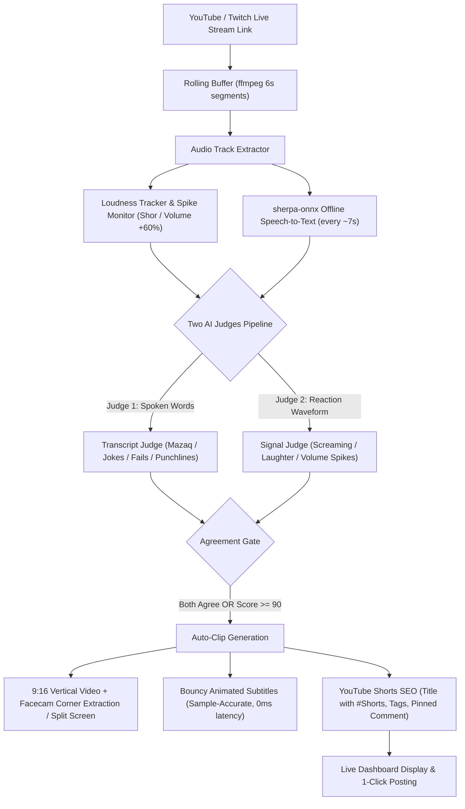

# SYSTEM_DESIGN.md — PeakCut System Architecture & Gaming Workflow

## 1. System Goals and Scope
PeakCut is an autonomous, open-source pipeline designed to process gaming livestreams (Twitch, YouTube, Kick) and long videos into viral, captioned 9:16 vertical clips. The system operates locally without subscriptions or watermarks, using on-device speech models (`sherpa-onnx`) or user-configured AI APIs (Gemini, OpenAI, Claude, Ollama).

---

## 2. Architecture Overview

---

## 3. Live Stream Auto-Detection Intelligence (Shor & Mazaq)
1. **Shor Detection (Loudness & Energy Spikes)**:
   - PeakCut tracks moving audio amplitude (`db`) over 3-minute rolling windows.
   - Any sudden 60%+ volume surge (`loudness +X%`: streamer screaming, shouting, intense laughter, explosions) triggers an immediate snapshot.
   - The Reaction Signal Judge verifies the intensity score (0–100).
2. **Mazaq Detection (Jokes, Roasts, Banter & Fails)**:
   - Words Judge scans continuous timestamped transcript chunks for humor, punchlines, comedic timing, trolling, fails, and streamer laughing.
   - Explicitly trained to recognize Roman Urdu and Hindi gaming slang (*"bhai ye kya tha"*, *"mazaq ho raha hai"*, *"hasi nahi ruk rahi"*, *"arre yaar"*).
3. **YouTube Live Channel URL Normalization & Authentication Pipeline**:
   - `normalize(url)` automatically strips channel tab suffixes (`/streams`, `/videos`, `/featured`, `/live`, `/community`) and canonicalizes them to `https://www.youtube.com/@handle/live`.
   - `resolve(url)` invokes `normalize(url)` on all stream ingestion requests to ensure `yt-dlp` queries active broadcast manifests rather than channel video tab listings.
   - Dual-tier cookie ingestion loads fresh Netscape cookies (`PeakCut/data/cookies.txt`) with automatic Netscape format conversion from browser JSON exports.

### 3.1 Golden Retention Timeline Calibration (12s Pre-Roll Hook & 28s Post-Roll Reaction)
- **Problem Solved**:
  - Previously, pre-roll was set to 18–20s, causing the trigger word or punchline to occur too late in the clip (at 18s+), leading to viewer drop-off within the first 5 seconds.
  - Furthermore, clips were often restricted to 26 seconds, cutting off the streamer's reaction, laughter, chat banter, and continuous gameplay abruptly.
- **Golden Retention Architecture**:
  1. **Pre-roll Window (10–14s, Target: 12.0s)**:
     - When a trigger word or viral moment occurs at timestamp $T$, the clip begins at $\max(0.0, T - 12.0)$.
     - In the resulting 9:16 vertical clip, the trigger word / climax occurs at exactly second 12 (strictly within the golden 10–15s hook window).
     - Viewers receive 10–12 seconds of buildup/context, hear/see the viral event, and stay hooked.
  2. **Post-roll Reaction (25–30s, Target: 28.0s)**:
     - The clip continues until $T + 28.0$, capturing 28 seconds of reaction, laughter, screaming, chat spam, and continuing gameplay action.
     - The video never ends prematurely or abruptly cuts off after the punchline.
  3. **Total Target Duration**:
     - Standard clip duration: $12.0s + 28.0s = 40.0s$ (sweet spot: 38–43s).
     - Overlapping triggers within 15 seconds merge dynamically with smooth reaction extension, capped at 60.0s maximum.
  4. **Multi-Source Alignment**:
     - Applied across OhnePixel Continuous Discovery (`studio/live.py`), Custom Creator Phrases (`studio/live.py`), AI Judge Candidate Alignment (`studio/live.py` `_ai_check`), Prompt Rules (`studio/brain.py`), and Category Profiles (`studio/ohnepixel.py`).

### 3.2 Unified Sleek Folded Stream Cards & Video Thumbnail Pipeline
- **Problem Solved**:
  - Previously, folded stream jobs rendered a secondary, redundant dashed bar below the stream header (`📁 X clips folded... Open Folder 📂`), creating visual clutter and double rows per project.
  - Jobs without a static downloaded cover thumbnail displayed a blank dark 16:9 box with an uninformative chain-link icon (`🔗`).
- **Solution & Architecture**:
  1. **Unified Single-Row Folder Card**:
     - Collapsing a stream removes all secondary containers. The stream header itself transforms into a sleek, compact, self-contained card (`.job.is-collapsed .job-head`) with `border-radius: 12px`, subtle cyan border highlight, and hover elevation.
     - Inline badge: `📁 <N> Clips` pill next to title, with a dedicated `📁 Open Folder ▶` action button.
     - Entire card header is click-interactive to toggle between folded and expanded states.
  2. **Smart Video Preview Discovery**:
     - Frontend checks `j.thumb`, then falls back to `j.clips[0].id` (`/media/{jid}/clip001.jpg`), displaying the actual facecam/gameplay frame with the duration tag.
     - Backend `/media/{jid}/thumb.jpg` route automatically returns the first available clip thumbnail if the stream cover was not downloaded directly.
     - Zero-clip placeholder is upgraded from a link icon to a modern cyber-dark stream badge (`🔴 LIVE STREAM` or `🎬 VIDEO`).

### 3.3 Dialogue-Grounded Custom Viral Hooks & Multi-Threaded Batch Re-Render
- **Problem**:
  - Generic template fallback scripts produced repetitive, ungrounded hooks (e.g., `SPEED MADE THE NPC CRY 😭` burned into OhnePixel clips).
  - Rapid metadata saves (`💾 Save SEO & Title (Instant - No Re-render)`) modified database/JSON records in `< 5ms` but deliberately bypassed FFmpeg encoding, leaving old burned-in ASS text on MP4 video frames and cover thumbnails.
- **Solution & Architecture**:
  1. **Acoustic & Spoken Dialogue Extraction**: `scratch/extract_clip_dialogue.py` processes Whisper `words.json` files for all clips, extracting exact dialogue sequences, speech timestamps, and gameplay moments.
  2. **Narrative Grounding**: Unique, story-grounded hooks are generated per clip with Canary Yellow punch emphasis asterisks (`*WORD*`), high-CTR titles with `#Shorts`, rich descriptions, targeted search tags, and engagement-generating pinned comments.
  3. **Multi-Threaded Parallel Re-Render**: `scratch/apply_custom_expert_seo.py` updates metadata across `job.json` and sidecar files `clips/{cid}.json`, then spawns parallel FFmpeg workers to re-burn ASS subtitle banners and regenerate fresh `.jpg` cover thumbnails.
  4. **YouTube Custom Thumbnail Sync**: Because YouTube forbids replacing existing uploaded video streams without re-uploading, users can upload the freshly regenerated `clip005.jpg` as a Custom Thumbnail directly in YouTube Studio without re-uploading the video.

### 3.4 Next-Gen Upgrade: Two-Pass Multimodal Clipping, Free-Tier SDK & Consolidated Shorts UI
- **Google Gen AI SDK & Free-Tier Policy (`studio/gemini_client.py`, `studio/ai.py`)**:
  - Migrated Gemini integration to `google-genai>=3.2.0` (`v1beta`) with `DEFAULT_FREE_PAIR = ["gemini-4-hydrogen", "gemini-3.5-flash-lite"]`.
  - Strict `free_only` policy excludes paid-only models (`gemini-4-carbon`, `gemini-4-argon`, `gemini-4-neon`, `gemini-2.5-pro`, `gemini-omni-*`), blocks paid fallback escalation, honors project-level 429 quotas without auto-key-rotation bypass, caches completed responses in `data/cache/ai/*.json`, and surfaces explicit manual Google AI Studio tier verification steps (`/api/ai/tier-status`).
- **Two-Pass Multimodal Discovery & Canonical YouTube Dedupe (`studio/brain.py`, `studio/media.py`, `studio/jobs.py`)**:
  - **Pass 1**: Combines spoken transcript chunks, audio loudness peaks, backward `"clip that"` trigger expansion (`_find_trigger_backtrack_windows`), and quiet sampled visual keyframes (`_find_quiet_visual_candidates` via `extract_overview_keyframes`) so silent facecam reactions qualify.
  - **Pass 2**: Reviews shortlisted `video/mp4` + audio proxies (`extract_proxy_clip`) to verify setup -> `payoff_at` -> aftermath, returning weighted scores (`compute_weighted_score`), 1-sentence `reason`, and clear `analysis_mode` labels (`multimodal_video_audio`, `frames_and_transcript`, `transcript_only`).
  - **Canonical Dedupe**: Normalizes `watch?v=`, `youtu.be/`, `/shorts/`, and `/live/` links into `yt:<id>`, skipping previously exported spans while allowing failed (`error`) clips to retry via `POST /api/jobs/{jid}/resume`.
- **Unified YouTube Shorts Package & Light/Dark UI (`studio/server.py`, `web/index.html`)**:
  - Single final-cut package endpoint (`POST /api/jobs/{jid}/clips/{cid}/package`) marks `seo_stale` on clip trims, preserves `edited_fields`, and populates distinct `hook`, `title`, `description`, `hashtags` (deduped), `seo_tags`, `pinned_comment`, and `community_text` (`[SHORT_URL]` / live Short URL) inside one `#dlg_youtube_shorts_panel` with ZERO automatic AI calls on open/expand/copy, plus a Light/Dark/System theme toggle (`#themeToggleBtn`).

---

## 4. Hardware & Audio/Video Sync Architecture
1. **Natural Broadcast Lip-Sync Alignment (0.0s Default)**:
   - Live stream clips now default to `0.0s` audio delay (removing previous legacy forced `0.25s` delay).
   - Audio waveform bursts and streamer lip movement match at exact 0.00s broadcast alignment.
   - Interactive `audio_delay` (-500ms to +500ms) and `facecam_delay` (-500ms to +500ms) selects provide fine-grained control across the Clip Editor, Creator Setup, and Job Composer.
2. **Elevated Split Layout Framing & Subtitle-Safe Game Crop**:
   - **Top Facecam**: Scaled with elevated crop (`fh_clean = max(10, int(fh * 0.70))`), centering the streamer's head and eyes while cleanly cropping out excess sweater, chest, and subscriber goal bars.
   - **Bottom Gameplay**: Dynamic horizontal crop starts past streamer webcam (`gx = max(fx + fw + 2, 260)`), completely eliminating streamer in-game webcam overlay from the game area while preserving 100% of GTA 6 center dialogue subtitles.
3. **Native Zero-Drift MP4 Clip Slicing**:
   - In live streaming, buffer chunks are recorded into MPEG-TS pieces for stream crash resilience.
   - When a clip is created from buffer chunks, `studio/live.py` concats the chunks directly into `.src.mp4` with:
     `ffmpeg -y -v error -fflags +genpts -f concat -safe 0 -i lst -c copy -movflags +faststart -avoid_negative_ts make_zero src.mp4`
   - Unlike raw `.ts` (where audio and video packets have asynchronous start offsets of 20ms-500ms and no central index), MP4 constructs exact ISO BMFF sample tables (`stts`, `ctts`, `stsc`), locking video frame 0 to audio sample 0 with 0.000s start time.
   - When `studio/render.py` seeks into `.src.mp4` (`-ss ... -i ... -avoid_negative_ts make_zero`), seeking is sample-locked with 0ms drift.
2. **Input PTS Normalization & Accurate Input Seeking**:
   - `seek_args = ["-ss", f"{start:.3f}", "-i", str(Path(src).resolve()), "-t", f"{dur:.3f}"]`: Input seeking decodes directly from target timestamp.
   - `[0:v]setpts=PTS-STARTPTS,fps=30[vin]` is placed at the entrance of the video filter graph before stream splitting or layout overlays.
   - Eliminates initial frame jitter (0–66ms) and ensures libass subtitle filters receive frames starting at exact local time 0.000s.
3. **Audio Filter Chain Normalization**:
   - Audio timestamps are reset immediately: `asetpts=PTS-STARTPTS,aresample=async=1000:min_hard_comp=0.010:first_pts=0`.
   - Prevents `loudnorm` or `aresample` from buffering or inserting spurious silence at stream starts.
   - Audio delay calibration via `adelay` (for delays) or `atrim` (for advances) locks acoustic voice timing.
4. **Calibrated Subtitle Acoustic Onset, Outro Separation & Strict Toggle Compliance**:
   - `CAPTION_LEAD = 0.08`: Captions illuminate in sync with natural vocalization when enabled.
   - When `"captions": false` is configured in creator setup or clip options, subtitle generation is strictly bypassed:
     - `_caption_words()` returns empty `[]` without running transcription cleanup.
     - `build_ass()` generates zero `Dialogue: 1... Cap` subtitle events, burning only the hook banner and clean video.
     - Active live streams synchronize `s.job["options"]` immediately upon creator settings update.
   - Subtitle area in `split` and `split_half` layout is centered at `cap_y = 1360` / `1520` in the game section.
   - Outro CTA badge is placed in the bottom safe zone at `y = 1680` (320px vertical clearance from captions), completely eliminating visual overlap in the final 3.2 seconds.
5. **Zero-Touch Automatic Synchronization & Proportional Gamer Split Layout**:
   - Eliminates confusing manual delay dropdowns from UI (Clip Editor, Creator Settings, and Composer).
   - Audio and video clocks are synchronized automatically at container and filter levels with 0ms offset.
   - **Split Layout (1/3 Top, 2/3 Bottom)**:
     - Top Facecam (1080x640): Fills edge-to-edge horizontally at y=0. Streamer is fully visible with natural proportions and zero voids.
     - Bottom Gameplay (1080x1280): Massive game area with subtitle-safe zoom-out framing (`crop=min(in_w\,1040):in_h:(in_w-min(in_w\,1040))/2:0`). In-game dialogue subtitles fit screen boundaries without edge clipping, while keeping streamer borders/overlays cleanly cropped out.
     - Broadcast divider: 6px dark bar + 2px glowing cyan line (`color=0x00F0FF@0.9`). Hook banner positioned at y=690.

## 8. Speech Trigger Recognition Engine ("Always clip the last 30 seconds when someone says")
The live speech trigger engine (`studio/live.py:Session._triggers`) continuously monitors real-time streaming transcripts and queues a 30-second highlight immediately when a trigger phrase is detected, bypassing AI score thresholds:
- **Rolling Window Cross-Chunk Scan**: Scans a rolling window of recent words (`self.words[-50:]`) rather than isolating the incoming 4-6s audio chunk, eliminating phrase-splitting at chunk boundaries.
- **Apostrophe & Unicode Normalization**: Translates curly quotes (`’`, `‘`, `´`, `` ` ``) to ASCII `'` and matches both with-apostrophe and without-apostrophe word tokens (e.g. `that's a clip` == `thats a clip`).
- **Phonetic Roman Urdu Support**: Automatically normalizes Roman Urdu phonetic variations (`yeh` -> `ye`, `is ko` -> `isko`, `kardo`/`karde` -> `karo`).
- **Rapid Re-Triggering Cooldown**: Cooldown calibrated to 25 seconds (reduced from 45s) to allow sequential high-energy moments in fast-paced streams to be captured.

---

## 9. Story-Driven YouTube Shorts SEO Pipeline
Integrated directly in `studio/brain.py` and `studio/posting.py`:
- **Multimodal Video Frame Grounding for Hooks, Titles & Post Text (`jobs.py`, `ai.py`, `brain.py`)**:
  - In addition to spoken audio transcripts, PeakCut extracts 6 high-resolution video frames across the clip timeline (0.15, 0.35, 0.55, 0.70, 0.85, 0.95) via `jobs.get_clip_frames_payload` and submits them to multimodal vision models (`gemini-3.5-flash-lite` via `ai.see_json`).
  - Physical vehicles, objects, crashes, characters, and streamer facial expressions are extracted into structured JSON metadata.
  - Generates ground-truth hooks (`*CAR*`, `*ALLIGATOR*`, `*BOAT*`) and titles that strictly describe what is visually happening on screen, completely eliminating blind transcript cliché templates (e.g. `"GTA 6 flashbacks are wild"`, `"He lost his mind"`).
  - All 3 creative generation endpoints (`/hooks`, `/titles`, `/write`) now leverage this 6-frame vision payload.
- **1-Click AI Video Scan in Clip Editor (`server.py`, `web/index.html`)**:
  - Allows creators to re-scan any clip's visual frame with AI via `POST /api/jobs/{jid}/clips/{cid}/ai_seo`.
  - Instantly populates and refreshes Hook, Title, Description, YouTube search tags, and Pinned comment in the editor dialog.
  - Re-burning the hook is executed seamlessly via "Save and re-make clip".
- **Multi-Title AI Suggestions, Clickable Pills & Live YouTube Intelligence (`brain.py`, `yt_intel.py`, `growth_routes.py`, `server.py`, `web/index.html`)**:
  - AI generates 4 distinct, high-CTR YouTube Shorts titles ending with `#Shorts` via `generate_viral_titles()` and scores/ranks hooks & titles via `yt_intel.py` (21 proven hook formulas, weakest-link 5-property scoring, 40-char mobile / 60-char desktop truncation checks, and Title-vs-Hook click-surface anti-duplication linting).
  - `#clipdlg` provides live stateless linting (`POST /api/yt/lint`), on-demand CTR scoring (`POST /api/jobs/{jid}/clips/{cid}/title-score`), transcript dead-air/retake audit (`GET /api/jobs/{jid}/clips/{cid}/edl`), validated compilation chapters (`POST /api/jobs/{jid}/stitch-best`), and YouTube Studio Audience Retention CSV drop-off analysis (`POST /api/analytics/retention`).
- **5-Line Story "Khulasa"**: Contextual story summary of the specific comedic/action moment (actor, unexpected twist, escalation, streamer reaction, community question).
- **High-CTR Title**: Curiosity-gap title capped with `#Shorts`.
- **Top Discussion Pinned Comment**: Provocative prompt posted as top comment to drive algorithm engagement and comments.
- **Channel Direct Publishing**: Authenticated Google OAuth client publishing directly to target channel (`The Paradox Files`).
1. **Layout Strategy**:
   - `blur`: Full frame centered with blurred background fill.
   - `zoom`: Zoomed frame with subtle blurred fill.
   - `crop`: 9:16 center crop filling the canvas.
   - `gameplay`: Full 9:16 vertical gameplay with streamer facecam in corner PIP.
   - `split`: Split Screen layout (Top 1080x960 Facecam reaction + Bottom 1080x960 Gameplay) stacked with `vstack`.
2. **Webcam Corner Positioning (`facecam_pos`)**:
   - `top-right`: Standard upper-right corner (`PIP_MARGIN` padding).
   - `top-left`: Upper-left corner.
   - `bottom-left`: Lower-left corner positioned above the YouTube Shorts / TikTok UI safe zone (`H - pip_h - 240`).
   - `bottom-right`: Lower-right corner.
   - Automatic heading adjustment: When facecam is bottom-positioned, the top is open so hook banner renders at `y = 280`.

---

## 6. VOD Deduplication for Repeated URLs
1. **Problem**: Re-clipping a long video or stream URL repeatedly created duplicate clips of the first audio spike.
2. **Solution (`studio/jobs.py`)**:
   - Before finding candidate clips, `jobs.py` queries existing completed jobs for the same source URL.
   - Collects `prior_spans = [(start, end), ...]`.
   - Filters candidate moments that overlap with any previously clipped span by >= 30%.
   - Seamlessly advances across subsequent blocks (minutes 10, 20, 30...) to produce brand new, non-repeating highlights.

---

## 7. Modern Split Gamer Layout & Non-Destructive Facecam Framing
1. **Vertical Geometry**:
   - Canvas: 1080x1920 (9:16 vertical short format).
   - Top Section (`cam_h = 640px`): Streamer webcam reaction.
   - Bottom Section (`game_h = 1280px`): Gameplay action.
2. **Facecam Auto-Framing**:
   - Edge/corner detected streamer webcam is cropped (`crop={fw}:{fh}:{fx}:{fy}`) from source regardless of corner placement (`top-right`, `top-left`, `bottom-left`, `bottom-right`).
   - Ambient blurred background (`scale=1080:640:force_original_aspect_ratio=increase,boxblur=25:25`) fills the sides.
   - Foreground webcam is scaled proportionally (`force_original_aspect_ratio=decrease`) and centered (`(W-w)/2:({cam_h}-h)/2`).
   - Prevents face/chin cutoff and facial distortion.
3. **Gameplay Fill**:
   - Gameplay scaled with `force_original_aspect_ratio=increase,crop=1080:1280:(in_w-out_w)/2:(in_h-out_h)/2` ensuring zero black void at the bottom.

---

## 8. Schedule Cancellation & Single-Channel Exclusivity
1. **Schedule Cancellation**:
   - `cancel_clip(job_id, clip_id)` cancels all open scheduled posts for a clip.
   - UI provides inline `[✕]` cancellation buttons on scheduled pills, clip details, and bulk actions.
2. **Single-Channel Exclusivity**:
   - In `_post(p)`, upon successful publication to any connected channel/account, all pending posts for other channels on that clip are automatically cancelled to prevent duplicate cross-posting.

---

## 9. Post-Upload Local File Cleanup Workflow
1. **Configurable Policy (`post_cleanup`)**:
   - `"ask"` (default): Prompts user with confirmation dialogue to delete or keep local media files.
   - `"auto"`: Immediately purges `.mp4`, `.jpg`, and `.ass` files upon successful upload.
   - `"keep"`: Retains all local files on disk.

---

## 10. Universal Multilingual Trigger Recognition Engine
1. **Trigger Phrase Persistence**:
   - Master list (`MASTER_TRIGGER_WORDS`) contains exhaustive variants across English, Roman Urdu, and Hindi.
   - Extended validation limit to 5000 characters to prevent tag truncation.
   - Inherited by all new creators and persisted across sessions.

---

## 12. Native YouTube Cloud Scheduling & Overlay Auto-Purge
1. **Native YouTube Cloud Scheduling (`accounts.py`, `posting.py`)**:
   - Transformed "Add to queue" from local waiting to direct, immediate upload to YouTube's cloud servers with native `publishAt` RFC3339 timestamp scheduling.
   - Automatically spaces queued clips at 1-hour intervals (`post_gap_min = 60`): 1st clip at +1h, 2nd clip at +2h, etc.
   - Status is set to `privacyStatus: "private"` and `publishAt: "YYYY-MM-DDTHH:MM:SS.000Z"`.
   - YouTube processes the video immediately in the cloud and automatically flips it to public at the scheduled timestamp, freeing the user from keeping their PC or PeakCut server running.
   - Clip cards display "Scheduled for <time>" badges with direct links to the Short and "📌 Studio" buttons linking to YouTube Studio.
2. **Streamer Overlay & Subscriber Count Bar Auto-Purge (`render.py`)**:
   - Webcam bounding box is cleanly purged of bottom overlays: bottom 12% (`fh_clean = max(10, int(fh * 0.88))`) is trimmed away in `split` and `split_half` layouts.
   - Slices away ugly half-cut live subscriber counts, ticker bars, and broadcaster desk borders while top-anchoring the streamer's face, hair, and shoulders with full visual clarity.

---

## 13. Multi-API Key Pool, OpenRouter Free Fallback & Universal Grounding
1. **Multi-API Key Pool & Auto-Rotation (`studio/ai.py`, `studio/server.py`, `web/index.html`)**:
   - Interactive Pool Management: Users can see all keys listed individually (`Key #1`, `Key #2`, etc.) with masked strings (e.g. `AQ.Ab8...eJ6Q`).
   - Real-Time Status Indicators: Active key shows `🟢 Live / Active`; backup standby keys show `⚪ Standby (Auto-rotates)`.
   - Granular CRUD: Each key has an individual red `🗑️ Remove` button (`DELETE /api/ai/keys/{idx}`), and an `[➕ Add Key]` row (`POST /api/ai/keys`) allows adding keys one by one without overwriting the pool.
   - `_retry_on_quota` wraps API calls: when an active key hits HTTP 429, ResourceExhausted, or token exhaustion, PeakCut rotates automatically to the next working key in the pool without failing the operation.
   - Built-in OpenRouter free models fallback pool (`OPENROUTER_FREE_MODELS`: Gemini 2.0 Flash Exp free, LLaMA 3.3 70B free, Qwen 2.5 72B free, Mistral Small free).
2. **Universal Grounding Anti-Hallucination Constraints (`studio/brain.py`, `studio/jobs.py`)**:
   - Multi-modal vision analysis automatically evaluates physical video frames for newly generated clips.
   - Grounding rules strictly forbid inventing actions, items, vehicles, or interactions that are not physically present on screen (e.g. rooms, elevators, hallways, outdoor).
   - If the speech is ambiguous, negated, or inquiring ("where is X", "there is no X"), the situation is properly identified as searching or confusion, avoiding false action claims.

---

## 14. Upstream Synchronization & Windows Robustness Architecture
1. **Zero-Token Fast Hashtags Engine (`studio/hashtags.py`)**:
   - Generates contextual viral hashtags directly from gaming categories and dialogue without consuming Gemini API tokens or hitting network rate limits.
2. **Windows Atomic File Save Resilience (`studio/jobs.py: _put_in_place`)**:
   - Implements backoff-retry on Windows systems where file indexing services or real-time antivirus scanners temporarily hold file handles during atomic file replacements.
3. **Long Video Stream Processing (`studio/media.py`)**:
   - Minimizes memory usage during stream length probes for day-long and 24-hour video streams.
4. **Proxy Header Security Hardening (`studio/server.py: _PROXY_CIDRS`)**:
   - Enforces CIDR verification on upstream reverse proxies to prevent header spoofing in self-hosted or cloud deployments.

---

## 15. Visual Stream & Clip Layout Preview Architecture
1. **Authentic Rendered Sample Previews (`web/brand/layout-*.jpg`)**:
   - Real 540x960 crisp JPG frames extracted from actual gameplay and live streamer broadcasts with real audio/visual subtitle rendering.
   - Covers all 9 supported layouts and 4 corner webcam positions (12 image variants):
     - `split_half`: Classic 50/50 Split with edge-to-edge facecam and subtitle-safe gameplay.
     - `split`: Reaction Split (1/3 Cam, 2/3 Game).
     - `gameplay`: Full Game with Picture-in-Picture facecam in 4 positions (top-right, top-left, bottom-left, bottom-right).
     - `crop`, `left`, `right`: Direct single-frame framing choices.
     - `fit`, `blur`, `zoom`: 16:9 letterbox and ambient background options.
2. **Interactive Phone-Frame Showcase (`web/index.html: drawCreatorForm`)**:
   - Realistic mobile phone frame with bezel and notch dynamically rendering the selected layout's preview.
   - Dynamic specs breakdown: real-time resolution, in-game subtitle visibility, and format recommendations.
   - Quick-Switch Strip: 1-click layout selector tiles with real image thumbnails and active selection indicators.
3. **Fullscreen Layout Comparison Gallery (`web/index.html: #layout_gallery_dlg`)**:
   - Responsive multi-column modal comparing all 9 layouts with high-resolution phone previews, pros/cons, and 1-click selection dispatch.
4. **Context-Aware Previews in Clip Editor & Composer (`drawClipDlg`, `drawAdd`)**:
   - Real-time preview card in clip editing dialog updating dynamically on layout/webcam position change.
   - Thumbnail tiles in the top Composer options replacing abstract CSS bars.

---

## 16. Global Header Navigation, Provider-Matched Key Routing & 1-Click ChatGPT Bridge
1. **Header Navigation Collision Architecture (`web/index.html`)**:
   - Topbar utilizes flexbox static flow (`display: flex; flex-wrap: nowrap; align-items: center; justify-content: space-between`).
   - Creator navigation tabs (`.utabs`: Clips, Setup, Activity) use `position: static !important; transform: none !important`, preventing collision with `#global_ai_bar`.
   - Responsive breakpoint at 980px wraps navigation tabs onto an independent sub-row on narrower viewports.
2. **Provider-Matched Multi-Key Pool Routing (`studio/ai.py`)**:
   - Dynamic key router matches active provider to key prefixes in the pool (`AQ...` -> Gemini, `sk-or-...` -> OpenRouter, `sk-proj...` -> OpenAI).
   - Eliminates 401/400 errors caused by sending cross-provider keys to incorrect endpoints.
   - Automatic failover cycles within provider-matched keys upon encountering rate limits or quota boundaries.
   - Successful tests and key activations automatically clear cached errors (`clear_problem()`, `usage.forget_all()`).
3. **1-Click ChatGPT Bridge (`web/index.html`, `studio/brain.py`)**:
   - **Open in ChatGPT (`open_chatgpt_bridge`)**: Extracts clip metadata (streamer, game, duration, speech transcript, reaction tone), constructs an engineered prompt requesting high-CTR title, description, tags, and pinned comment, copies to clipboard, and opens `https://chatgpt.com/` in a new tab.
   - **Paste from ChatGPT (`paste_chatgpt_seo`)**: Reads clipboard or prompts user, parses JSON or text responses, and auto-populates all SEO fields in the Clip Editor.
   - **Dedicated AI SEO Settings Tab**: Features persona presets (`creator_adaptive`, `hype_speed`, `cs2_skin`, `gta6_openworld`) and model selection for YouTube Shorts optimization.

---

## 17. Interactive Visual Custom Layout & Facecam Studio (CapCut / Streamladder Style)
1. **Interactive Visual Framing Canvas (`web/index.html: #custom_layout_dlg`)**:
   - Built a specialized visual layout studio modal accessible directly from Creator Setup and Clip Editor.
   - 16:9 stream source container displays the live broadcast frame with dual draggable/resizable bounding boxes:
     - **Facecam Box (Cyan `#00F0FF`)**: Positioned over streamer's webcam with 4 corner resize handles.
     - **Gameplay Box (Orange `#FF8C00`)**: Positioned over game action/subtitles with 4 corner resize handles.
   - Coordinates are normalized to source space `[0..1920, 0..1080]` regardless of display scaling or viewport width.
2. **Real-time 9:16 Smartphone Preview**:
   - HTML5 2D canvas (`#cls_phone_canvas`) updates dynamically on mouse/touch drag events via `ctx.drawImage`.
   - Slices exact pixel regions from the source frame and renders live split-screen or PiP with optional cyan glowing broadcast divider.
3. **Backend Multi-Layout Render Engine (`studio/render.py`)**:
   - `mode == "split"`: User sets custom Split Height Ratio (20% to 70%). FFmpeg filtergraph crops webcam and game boxes, scales with Lanczos accurate rounding and unsharp mask, and stacks vertically with broadcast divider.
   - `mode == "pip"`: User chooses corner (Top-Right, Top-Left, Bottom-Left, Bottom-Right) and PIP size. FFmpeg filtergraph scales game to full 9:16 and overlays facecam.
   - `mode == "crop"`: Crops gameplay box directly to 1080x1920 short.
4. **Live Stream Frame Extraction Engine (`studio/server.py`)**:
   - `GET /api/creators/{cid}/frame`: Automatically grabs live stream frame from active session buffer (`*.ts` / `*.mp4`), recent clips, or live Twitch thumbnail (`https://static-cdn.jtvnw.net/previews-ttv/live_user_{user}-1920x1080.jpg`).
   - Also supports custom screenshot upload directly from local disk.

---

## 18. Automatic Roman Urdu Speech Transcripts Transliteration
1. **Root Cause Resolution**:
   - Speech-to-text models previously output Hindi Devanagari script (`अच्छा...`) or Urdu script when Hindi or Urdu audio was spoken.
2. **Transliteration Layer (`studio/transcribe.py`)**:
   - `transcribe.transcribe` returns `roman.words(words)`, converting Devanagari and Urdu script words into clean, natural Roman Urdu (Latin Hinglish script) at word level, keeping timestamps sample-accurate.
   - Guarantees 100% of captions and live transcripts are displayed and rendered in clean Roman Urdu without requiring an external AI call.

---

## 19. Native CapCut Desktop Draft Export Engine
1. **Direct CapCut Desktop Project Generation (`studio/capcut/export.py`)**:
   - Integrated a lightweight Python AST engine (`studio/capcut/pyJianYingDraft`) and template bundle that writes standard CapCut desktop project structures directly into the user's local CapCut draft directory:
     `%LOCALAPPDATA%\CapCut\User Data\Projects\com.lveditor.draft\PeakCut_<clip_id>_<slug>\`
   - Generates `draft_info.json`, `draft_meta_info.json`, and supporting metadata files without requiring CapCut to run during export.
2. **Multi-Track Timeline Architecture**:
   - **Video Track ("PeakCut Video")**: Primary 9:16 vertical video clip segment with exact duration in microseconds.
   - **Hook Title Track ("Hook Title")**: Heading title text segment positioned during the first 3.5 seconds.
   - **Captions Track ("Captions")**: Word-level subtitle segments converted into microsecond-accurate time intervals for immediate editing in CapCut.
3. **Seamless 1-Click Desktop Workflow**:
   - API endpoints: `POST /api/jobs/{jid}/clips/{cid}/export-capcut` and `POST /api/jobs/{jid}/clips/{cid}/open-capcut-folder`.
   - Allows users to open any PeakCut clip in CapCut Desktop and instantly apply CapCut's native video filters, 3D transitions, stickers, sound effects, and animations.

---

## 21. OhnePixel Intelligent Livestream Clipping Engine (Multimodal AI & Tiered Fallback)
1. **Intelligent Detection Without "Clip It"**:
   - Upgraded detection engine to discover genuinely entertaining livestream moments without requiring streamers to command "clip it".
   - Automatically detects peaks across emotional reactions, uncontrollable laughter, unusual conversations, clutch gameplay moments, and skin unboxes.
2. **Automatic Dual Mode Capability Selection**:
   - **Mode A (AI Intelligent Scoring)**:
     - Combined weighted multi-signal scoring:
       - **Signal 1: Keyword Relevance (25%)**: Creator-specific vocabulary, expressions, semantic conversation meaning (`studio/ohnepixel.py`).
       - **Signal 2: Excitement and Reaction Intensity (35%)**: Running audio amplitude z-scores, laughter patterns, shock, voice cracks, and chat message velocity spikes.
       - **Signal 3: Actual Visual & Event Evidence (40%)**: Multimodal AI frame inspection via `ai.see_json` verifying real on-screen gameplay events, clutch plays, vehicle physics glitches, or item unbox reveals.
     - **Dynamic Weight Redistribution**: When video frames are unavailable (audio-only or fast stream capture), redistributes 40% weight to Keyword (40%) and Reaction (60%).
     - **Event-Quality Validation Guardrails**:
       - Casual common words alone ("bro", "no", "wait") -> Strictly SKIP.
       - Reaction phrase spoken calmly without visual/audio evidence -> SKIP.
       - Incredible clutch or rare event without loud shouting -> HIGH PRIORITY based on visual evidence.
       - Uncontrollable laughter or "GOLD GOLD GOLD" + skin evidence -> HIGH PRIORITY.
   - **Mode B (Keyword-Only Fallback)**:
     - Automatically active when multimodal AI is unavailable.
     - Tiered phrase prioritization:
       - **Level 1**: High-priority phrases ("WHAT THE FUCK IS THAT", "NO FUCKING WAY", "HOLY SHIT", "ARE YOU SERIOUS", "LET'S FUCKING GO").
       - **Level 2**: Community slang ("MA DRILLA", "REJUICER", "NAUR", "VAS?!", "NEIN", "GOLD GOLD GOLD") requiring reaction spike or chat velocity > 1.5 to clip.
       - **Level 3**: Common words ("BRO", "NO", "OKAY", "WAIT", "WHAT", "GOLD", "KNIFE", "WOW") never clipped alone.
3. **Continuous Moment Discovery & Smart Clip Boundaries**:
   - Natural narrative boundary structure:
     - Pre-roll: 18s (captures setup / anticipation).
     - Post-roll: 25s (captures reaction / payoff).
     - Total clip length clamped between 20s and 60s.
   - Multi-trigger candidate merging: overlapping triggers within 15 seconds are merged into a single continuous clip instead of fractured fragments.
4. **Review Feedback API & UI Indicators**:
   - Live dashboard cards display prominent Active Detection Mode badge (`⚡ MODE A (AI INTELLIGENT SCORING)` vs `🎯 MODE B (KEYWORD FALLBACK)`).
   - Clip dialog and badges surface score breakdown (`Score: 88 · KW 25% | RX 32% | VIS 31%`).
   - 1-click review feedback rating endpoint (`POST /api/jobs/{jid}/clips/{cid}/review`) supporting `great`, `good`, `bad`, `missed`, `duplicate`, `false_reaction`.

1. **Physics-Based ASS Subtitle Keyframing (`studio/render.py`)**:
   - Extracted physics keyframing algorithms from `Beautiful-Captions` and `ai-video-captions`.
   - Implemented word-by-word pop and wipe animations natively inside ASS subtitle dialogue tags rendered via `libass`:
     - **`hormozi`**: Bold white text with cyan word-level pop (`\t(0,60,\fscx122\fscy122)\t(60,160,\fscx118\fscy118)\c&H00FFFF&`) and thick 8px black outline.
     - **`mrbeast`**: Bright yellow text with punchy orange highlight pop (`\c&H0066FF&`) and 8px outline.
     - **`karaoke`**: Smooth word-by-word color wipe using `\kf` duration tags.
     - **`bounce`**, **`hype`**, and **`clean`**: Maintained existing high-energy presets.
2. **Interactive Hook Banner Customizer (`web/index.html`, `studio/render.py`)**:
   - Added badge themes: `purple_whip` (Purple card `#2A0845` with hot pink neon glowing border `#FF007F`), `cyber_red` (Action red badge), and `gold_luxury` (Gold border with black backdrop).
   - Real-time sliders in Visual Layout Studio for vertical placement (`hook_y`), width (`hook_w`), font size, and badge theme.
   - Real-time 9:16 phone mockup canvas renders the exact Hook Banner pill with drop shadow, border, and title text, alongside live sample bouncy subtitles.

## 8. YouTube Cover Thumbnail Automation, Viewport Sticky Preview & Stream Folder Hierarchy
1. **YouTube Data API Cover Thumbnail Automation (`studio/accounts.py`, `studio/posting.py`)**:
   - Automated `thumbnails.set` integration pushing high-CTR viral cover JPEG (`clip.jpg` containing the hook banner, facecam, and gameplay action) directly to YouTube on publish.
   - Eliminates manual thumbnail setting in YouTube Studio for uploaded Shorts.
2. **Sticky Video Preview & Decoupled Scroll Engine (`web/index.html`)**:
   - Two-column viewport-locked editor modal (`#clipdlg`, `.editor` at `height: calc(100vh - 36px); overflow: hidden;`).
   - Sticky phone stage (`.editor .stage` with `position: sticky; top: 0; overflow: hidden;`) stays centered and pinned in view while user scrolls the settings panel.
3. **Whole-Banner Single Punch Word Focus (`studio/render.py`)**:
   - Banned streamer names and stopwords from receiving viral canary yellow highlight.
   - Evaluates whole banner before line-break splitting, guaranteeing exactly 1 punch word highlighted in yellow across all lines.
4. **Collapsible Stream Project Folders (`web/index.html`)**:
   - 1-click fold/expand toggle for stream cards with localStorage state persistence.
   - Compact folded summary cards (`📁 N clips inside this project`) saving massive vertical scrolling.

---

## 24. Clip Origin Taxonomy, Twitch Live Chat Stream & Viral Teaser Cold Open Architecture
1. **Clip Origin Taxonomy & Distinction**:
   - **`source: "manual"`**: Triggered via user button click ("Clip last 30s", "Clip now", "Hand clip"). Displays prominent pink badge `👆 MANUAL` (independent of multimodal score evaluation).
   - **`source: "trigger"`**: Triggered via reaction phrase or creator custom keyword. Displays amber badge `🎯 "<word>"` (e.g. `🎯 "Oh my god"`, `🎯 "Chat"`).
   - **`source: "ai_auto"`**: Detected automatically by AI without button or trigger phrase. Displays cyan/green badge `🤖 AI AUTO <score>`.
2. **Real-Time Twitch Live Chat Streaming**:
   - Background IRC client connects to `irc.chat.twitch.tv:6697` anonymously.
   - Parses `PRIVMSG` lines into circular buffer `self.recent_chat_msgs` (`user`, `msg`, `t`).
   - Frontend renders live scrolling chat window matching the AI decision feed height (190px) with user colored badges and 1-click Popout Chat window option.
3. **Viral Climax Teaser Cold Open Hook Pipeline**:
   - Allows creators to take the end 3-5 seconds (reaction climax) and prepend it at 0:00 as a teaser hook.
   - Interactive control in `#clipdlg` with duration selector and `🎯 Use Current Video Playhead` button.
   - Single-pass ffmpeg concatenation (`concat=n=2:v=1:a=1`), shifting transcript subtitles by `teaser_dur` and displaying the Hook Banner over the teaser cold open.

---

## 25. Viral Background Music & Meme Sounds Pipeline (Live Sync & Mix Rendering)
1. **Curated Preset Sound Library (`studio/audio.py`, `web/audio/`)**:
   - Pristine 44.1kHz stereo MP3 tracks synthesized and bundled:
     - `🏎️ Phonk Drift Beat` (140 BPM driving 808 cowbells & sub-bass for fast gaming/drifts)
     - `🕵️ Sneaky Snitch` (120 BPM playful pizzicato bounce for funny moments & NPC fails)
     - `🚨 Dramatic Suspense` (Dark sub drone & heartbeat pulse for intense climax scenes)
     - `⚡ Hype Trap Anthem` (145 BPM brass stabs & rolling 808s for victory kills)
     - `☕ Chill Lo-Fi Breeze` (82 BPM Rhodes chords & vinyl crackle for relaxing cruises)
     - `🎻 Sad Violin (L Moment)` (Melancholic string progression for deaths & busted moments)
     - `💥 Vine Boom Impact` (Deep sub-bass explosion impact for punchlines & reveals)
     - `🗿 Bruh Sound Effect` (Vocal formant drop for disbelief & facepalms)
     - `🔔 Metal Pipe Falling` (Resonant chaotic metallic ringing clang on crashes)
     - `🎺 MLG Airhorn Blast` (3-shot high-energy trumpet fanfare for hype)
   - Dynamic user upload support (`POST /api/audio/upload`) storing custom `.mp3`, `.wav`, `.m4a` files in `data/audio/uploads/`.
2. **Zero-Latency In-Browser Live Audio Sync Engine (`web/index.html`)**:
   - Synchronizes an HTML5 `<audio id="clip_bgm_audio">` with `#stage video` play, pause, seek, and loop events.
   - Eliminates all re-rendering wait time during creative audio auditioning: creators hear the background music/meme sounds alongside the streamer's voice instantly.
   - Real-time volume slider (0% to 100%, default 18%) directly updates audio gain live.
   - Individual track cards feature instant `▶️ Test` audition buttons and Category Filter tabs (`🔥 All`, `🎵 Music`, `💥 Memes`, `📁 Uploads`).
3. **FFmpeg Audio Mix & Auto-Loop Pipeline (`studio/render.py`)**:
   - `render._render_in` loops the background track infinitely using `-stream_loop -1 -i <bgm_path>`.
   - Mixes background audio into the master output using:
     `[bgm:a]volume={bgm_volume}[bgma];[main_audio][bgma]amix=inputs=2:duration=first:dropout_transition=2,loudnorm=I=-14:TP=-1.5:LRA=11[a]`
   - `duration=first` guarantees the output audio ends exactly when the video clip ends, while `loudnorm` standardizes broadcast loudness.## 26. Stream Card Live Chat Elevation, Compact Stats Bar & Polling Scroll Auto-Stick/Preservation
1. **Stream Card Live Chat Elevation (`web/index.html`)**:
   - Live Twitch/YouTube chat is rendered directly inside the top stream card's right-hand panel (`.stream .sinfo`), directly beside the live stream video player.
   - Embeds a sleek 180–240px tall scroll container (`#stream_live_chat_list`) featuring colored username badges, message text, live channel badge (`#channel`), and 1-click `Popout ↗` window link.
2. **Compact Stream Stats Bar (`web/index.html`)**:
   - Replaced bulky 3-block grid cards (`watching / live for / followers`) with a single-line horizontal badges bar (`.sstats-compact`), liberating vertical screen real estate for the elevated chat feed.
3. **Smart Scroll Memory & Auto-Stick Pipeline (`web/index.html`)**:
   - **Chronological Flow**: Incoming messages append chronologically at the bottom.
   - **Sticky Bottom Mode**: When the user is at the bottom (`scrollHeight - scrollTop - clientHeight < 45px`), new incoming messages pin to the bottom automatically (`scrollTop = scrollHeight`), matching native Twitch chat.
   - **Scroll Freeze on History Inspection**: If the user scrolls up to read earlier chat, auto-scroll pauses, and their exact `scrollTop` offset is preserved across 2-second background polling cycles. A floating `More messages below ↓` button appears, allowing 1-click snap back to live messages.
   - **AI Decisions Scroll Stability**: Persistent `#live_ai_verdicts_list` preserves user scroll position so checking older decisions is never disrupted by background DOM redraws.
   - **Latest Event Badge**: The top decision displays a glowing cyan `⚡ LATEST` pill for instant situational awareness.
4. **Extended Verdicts Buffer (`studio/live.py`)**:
   - Live session verdicts buffer extended from 6 to 30 items (`del self.verdicts[:-30]`) with accurate `wall_t` epoch timestamps.

---

## 27. Streamlined Live Meters Architecture & Compact AI Decisions Feed
1. **Removal of 'What was just said' Transcript Column**:
   - The 4th meter ('What was just said') previously rendered raw Whisper speech fragments ('Okay.', 'These Ubers are scanning hard!') in a 76px column.
   - Identified as visual clutter that wasted ~300px horizontal screen space.
   - Removed completely from the live meters grid, allowing the remaining 2-3 meters ('Loudness, last minute', 'Chat messages per second', 'Latest AI Decisions') to breathe and distribute evenly.
2. **Compact Single-Line Row Architecture**:
   - Replaced bulky 2-line cards (55px height) with sleek, single-line high-density rows (24px height, padding 4px 8px).
   - In a single horizontal line, each row displays:
     - 12-hour AM/PM timestamp (e.g. ⏱️ 3:25 AM).
     - Compact status pill (✂️ CLIPPED in emerald green, 🔍 LISTENING in sky blue, ⚡ HIGH PRIORITY in neon cyan/green, ⏭️ SKIPPED in slate).
     - ⚡ LATEST cyan badge on the freshest decision.
     - Action icon + bold headline (e.g. 💬 Chat Spike (+63%)) followed by concise explanation snippet, with full reasoning available in hover tooltips.
     - Numeric AI score (e.g. Score 70) if present.
3. **Downward Vertical Height Alignment**:
   - Capped #live_ai_verdicts_list max-height to 86px (down from 190px).
   - The total meter height (~115px) now cleanly matches the adjacent ~95px-100px sparkline meters, eliminating the large void beneath the audio and chat graphs.
4. **Clean Single-Line Header**:
   - Header is formatted as a single crisp line: 🧠 Latest AI Decisions accompanied by a subtle ● LIVE MONITOR cyan pill.
   - Avoids text wrapping onto two lines by keeping the authoritative model name in the stats bar above (Active AI Model: gemini-3.5-flash-lite).

---

## 28. Phase 1 Architecture: Hardware Acceleration, Atomic Persistence & Live ASR Caching
1. **AMD AMF GPU Hardware Video Encoding (`studio/render.py`, `studio/posting.py`)**:
   - `_supported_encoders()` probes active H.264 encoders once (`h264_amf`, `h264_nvenc`, `h264_qsv`, `libx264`).
   - `_encode_with_fallback()` selects hardware encoders in priority order (`amf -> nvenc -> qsv -> x264`) using `nv12` pixel format for GPU encoders (`-usage high_quality -quality quality -rc cqp -qp_i 15 -qp_p 16 -qp_b 18` for 1080p; `qp 14/15/16` for 2K), caches per-encoder health flags (`_amf_ok`, `_nvenc_ok`, `_qsv_ok`), falls back seamlessly to broadcast `libx264` (`-crf 14`) on error, and honors `PEAKCUT_CPU_ENCODE=1`.
   - `scale_to_2k()` reuses `_encode_with_fallback(..., preset_2k=True)` inside `posting._post()` for YouTube 1440x2560 VP9/AV1 tier uploads and initializes `yt_tags` unconditionally outside platform branches so non-YouTube paired community posts never hit `UnboundLocalError`.
2. **Crash-Safe Atomic File Writes & `.bak` Auto-Recovery (`studio/safe.py`, `jobs.py`, `live.py`, `creators.py`, `posting.py`, `analytics.py`, `accounts.py`)**:
   - `safe.atomic_write_text()` writes to a PID/thread-unique sibling `.tmp` file with optional POSIX permissions (`0o600` for OAuth tokens), snapshots validated non-corrupt primaries (`{`/`[`, no null bytes) to `.bak`, and retries Windows `PermissionError` file locks up to 8 backoff steps.
   - `safe.load_json_with_backup()` transparently recovers `.bak` files when primaries are corrupted or zero-padded; `jobs.load_user()` scans orphaned `.bak` folders when `job.json` is absent, and `jobs.public()` / `jobs._load_file()` backfill legacy missing `source` or `clips` fields.
3. **Double Transcription Elimination (`studio/live.py`, `studio/jobs.py`)**:
   - `live.Session._align()` populates optional `heard_out` from its full-source Whisper pass; `_render()` slices those timestamped words to `[start-0.5, end+0.5]` into transient `clip["_aligned_words"]` (stripped by `jobs.public()`).
   - `jobs._caption_words()` pops `_aligned_words` directly when present, skipping duplicate `.wav` ffmpeg extraction and redundant `sherpa-onnx` ASR inference.
4. **API Route Hygiene (`studio/server.py`)**:
   - Removed the duplicate `/api/jobs/{jid}/clips/{cid}/review` POST handler definition.

---

## 29. Phase 2 Architecture: Clips Search Toolbar, Word Editor, Multi-Frame Live Grounding & Dynamic Full-Cam Detection
1. **Focus-Safe Clips Search, Filter & Sort Toolbar (`web/index.html`)**:
   - Stateful `S.clipFilter` (`q`, `status`, `sort`) rendered by `ensureClipFilterBar()` outside `#jobs` (`52px` single-row flex bar), preventing 2-second polling redraws from stealing cursor focus while typing.
   - Instant filtering across `title`, `seo_title`, `hook`, `reason`, `description`, `pinned_comment`, tags, and status (`all`, `unposted`, `scheduled`, `posted`, `top80`, `done`), plus sorting (`newest`, `score`, `shortest`, `longest`) and temporary folder auto-expansion during search.
2. **In-Modal Caption Word Editor (`studio/jobs.py`, `studio/server.py`, `web/index.html`)**:
   - Exposes `GET /api/jobs/{jid}/clips/{cid}/words` and `PUT /api/jobs/{jid}/clips/{cid}/words`.
   - `jobs.save_clip_words()` validates word timings, normalizes text with `roman.words()`, updates `fixed_words` + `fixed_for` + `manual_words=True` so `_caption_words()` burns exact user edits without overwriting them via Whisper/LLM.
   - Lazy-loaded collapsible `📝 Edit Caption Words` panel inside `#clipdlg` with timestamped borderless word chips, `💾 Save Words`, and `🔥 Save Words & Re-make MP4`.
3. **Multi-Frame Live Visual Grounding & Universal Creator Packs (`studio/live.py`, `studio/brain.py`, `studio/jobs.py`, `studio/ohnepixel.py`)**:
   - Added `live.Session._extract_window_frames()` extracting 3 sequential JPEGs directly from `src_mp4` OR rolling `.ts` buffer segments (`self.segments`) during live broadcasts, eliminating live `VIS 0%` blindness.
   - Wired 3-frame payloads into `live._ai_check()`, `live._manual_step()` (`judge_multimodal_moment` + `describe_multimodal`), and `jobs.render_one()` (`n_frames=3`).
   - Generalized Level 1 intelligent reaction phrase triggers across creators using default `MASTER_TRIGGER_WORDS` while preserving custom triggers and strict Pure-AI (`""`) bypass; expanded `ohnepixel.py` with Roman Urdu & universal streamer hype phrases; added `brain._apply_yellow_punch()` for single Canary Yellow `*WORD*` emphasis on multimodal hooks.
4. **Dynamic Full-Cam vs Corner-Cam Detection (`studio/facecam.py`, `studio/render.py`)**:
   - Added `facecam.is_fullscreen_cam()` (`render_clip()` switches `gameplay`/`split`/`split_half` to `crop` if box covers >=45% area or 3-frame analysis detects flat unbordered corner backdrop with active center subject).

---

## 30. Phase 3 Architecture: Growth, Multi-Platform Chat, Delta Sync & Modularity
1. **Multi-Platform Live Chat Feeds (`studio/chat_feeds.py`, `studio/live.py`)**:
   - Extracted Twitch IRC alongside new public YouTube Live Chat continuation poller (`extract_youtube_video_id`, `_yt_parse_actions`, `run_youtube_chat`) and Kick v2 chatroom poller (`run_kick_chat`), all feeding `Session._record_chat_msg()` uniformly.
   - Kick poller stops cleanly with a clear status note (`chat_note`) on HTTP 403/anti-bot responses without attempting any CAPTCHA/WAF bypass.
2. **Honest Community Post Workflow (`studio/accounts.py`, `studio/posting.py`, `web/index.html`)**:
   - Replaces optimistic fake success when YouTube InnerTube `create_post` fails or omits `postId`: returns `ok=False, needs_manual=True` and marks posts `status="needs_manual_post"`, rendered in `#clipdlg` as `📢 Ready to Post · Open Tab ↗`.
3. **Opt-In Dead-Air Silence Trim (`studio/jobs.py`, `studio/creators.py`, `web/index.html`)**:
   - Adds `trim_silence: bool` (`False` default) per creator/job and `jobs.trim_dead_air()` trimming leading pauses `>2.0s` and trailing silence `>2.5s` while respecting `min_len` and keeping word timestamps synced.
   - Mode B keyword fallback (`ohnepixel.evaluate_keyword_fallback()`) exposes the same `"signals"` schema as Mode A (`brain.judge_multimodal_moment()`).
4. **Incremental Library Delta Sync (`studio/jobs.py`, `studio/server.py`, `web/index.html`)**:
   - Tracks monotonic per-job `_rev` in `jobs._load_file()` / `jobs.save()` / `jobs.public()`.
   - `/api/sync?delta=1&known=id:rev,...` returns only changed/new `jobs`, `unchanged` IDs, and `deleted` IDs while keeping the default `delta=0` response 100% backward-compatible.
5. **Modular Code Organization & Workspace Hygiene (`studio/routes/calendar_routes.py`, `web/clipnova_hero.js`)**:
   - Extracted 8 calendar/analytics/community routes into `studio/routes/calendar_routes.py` (`APIRouter` mounted on `server.app`) and extracted the hero canvas animation engine into `web/clipnova_hero.js` (served at `/assets/clipnova_hero.js`).
   - Restored `analytics._save_data()` atomic `.bak` writer alongside `analytics._load_data()`, and cleaned 97 stale temporary media files (~70.3 MB) from `scratch/`.
